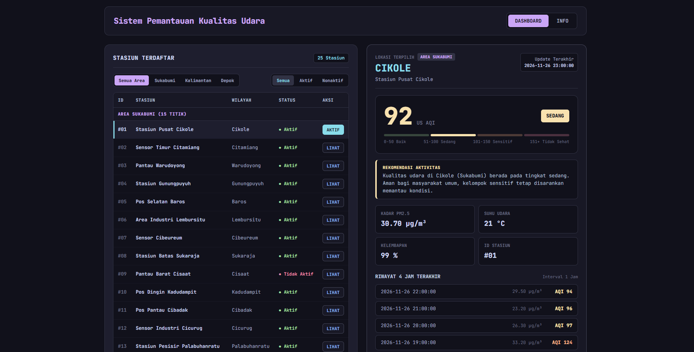

# Sistem Pemantauan Kualitas Udara (Air Quality Monitor)

Aplikasi web berbasis **PHP prosedural (Non-OOP)** dan **MySQL** untuk memantau indeks kualitas udara (**US AQI**), kadar partikel halus (**PM2.5**), suhu udara, serta kelembapan secara berkala pada **25 titik stasiun** yang terbagi ke dalam tiga wilayah pemantauan (**Sukabumi**, **Kalimantan**, dan **Depok**).

---

## Tim Pengembang — Kelompok 2

**Program Studi Sistem Informasi (SI25I) — Universitas Nusa Putra**

| No | Nama Lengkap | NIM |
| :--- | :--- | :--- |
| 1 | Rieffa Dwi Syaharani | `20250050087` |
| 2 | Xena Levina Edriana Br. Regar | `20250050101` |
| 3 | Ruaida | `20250050049` |
| 4 | Salwa Haulia | `20250050078` |
| 5 | Diaz Abyansyah Ramdhani | `20250050062` |

---

## Tampilan Antarmuka



---
## Fitur Utama

- **Pemisahan Tiga Wilayah Pemantauan:** Mengelompokkan stasiun secara terstruktur berdasarkan **Area Sukabumi (15 titik)**, **Area Kalimantan (5 titik)**, dan **Area Depok (5 titik)** lengkap dengan filter wilayah serta filter status (`Aktif` / `Tidak Aktif`).
- **Sinkronisasi Otomatis Per 1 Jam (`Auto-Sync`):** Mengambil data terbaru dari Open-Meteo API setiap 1 jam sekali dan memperbarui baris pengukuran terbaru pada database MySQL (`air_quality`) tanpa duplikasi data.
- **Riwayat 4 Jam Terakhir:** Menampilkan tren pengukuran kualitas udara (PM2.5 dan US AQI) dengan interval 1 jam ke belakang.
- **Deteksi Status Stasiun Nonaktif:** Apabila status stasiun di tabel `lokasi_pantau` diubah menjadi `Tidak Aktif`, sistem otomatis menghentikan penarikan data API dan menampilkan indikator stasiun nonaktif pada *dashboard*.
- **Antarmuka Minimalis:** Menggunakan palet warna **Catppuccin Mocha** dan tipografi **JetBrains Mono** tanpa animasi untuk keterbacaan data yang optimal.

---

## Struktur Database (`air_quality`)

Database relasional terdiri dari dua tabel dengan relasi **1:N** (*One-to-Many*):

1. **`lokasi_pantau`** — Menyimpan master data stasiun (`id_lokasi`, `nama_stasiun`, `wilayah`, `status`, `region`).
2. **`data_kualitas_udara`** — Menyimpan data pengukuran terbaru setiap stasiun aktif (`id_data`, `id_lokasi`, `waktu_pengukuran`, `pm25`, `aqi`, `kategori`).

---

## Cara Menjalankan Proyek (Lokal via XAMPP)

1. **Clone atau Unduh Repository**
   ```bash
   git clone [https://github.com/diazabiansyahramdani-cmd/Air-Quality-Monitor.git](https://github.com/diazabiansyahramdani-cmd/Air-Quality-Monitor.git)
